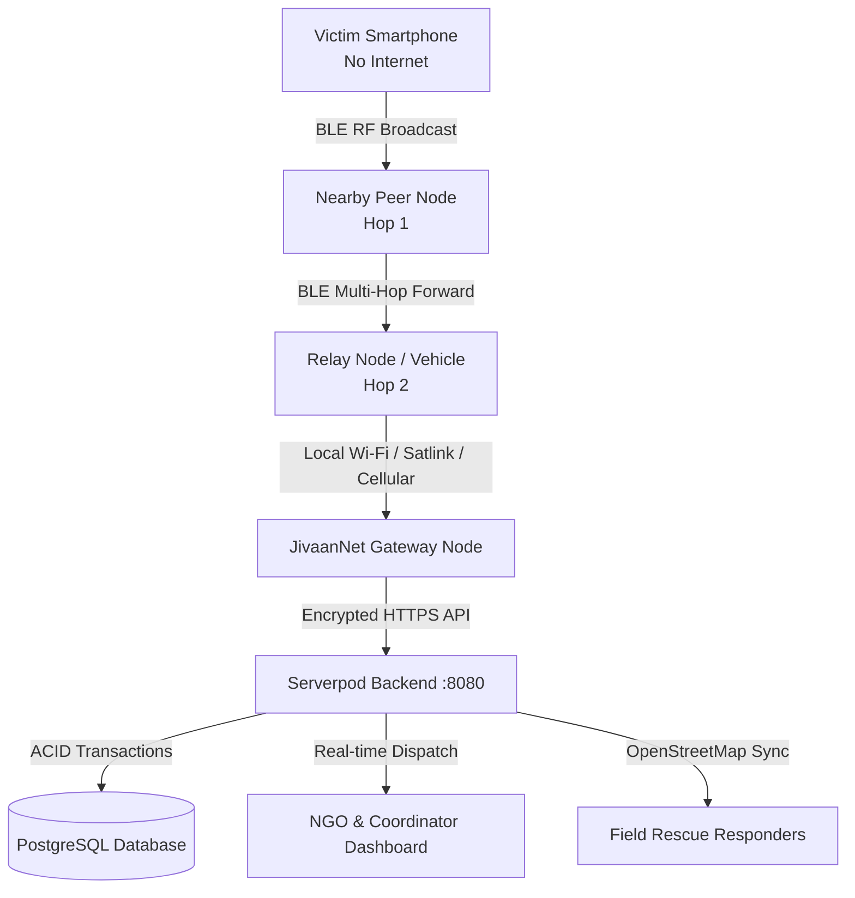

# 🚨 JivaanNet — Decentralized P2P Emergency Mesh & Disaster Response Network

[](https://flutter.dev)
[](https://serverpod.dev)
[](https://dart.dev)
[](https://www.postgresql.org)
[](LICENSE)
[-success)](https://github.com/durgesh-1801/JivaanNet)

> **A resilient, offline-first emergency lifeline connecting citizens and disaster relief coordinators when cellular towers and the internet fail.**

---

## 📌 Problem Statement

During catastrophic natural disasters — earthquakes, flash floods, hurricanes, and severe power grid blackouts — centralized telecommunication infrastructure collapses within minutes. Victims find themselves in critical danger with zero cellular connectivity, unable to reach emergency dispatchers, coordinate with neighbors, or transmit vital coordinates for rescue.

---

## 💡 The JivaanNet Solution

**JivaanNet** is an offline-first disaster response ecosystem built with **Flutter** on the frontend and **Serverpod (Dart)** on the backend. When the internet is severed, JivaanNet transforms everyday smartphones into decentralized Bluetooth Low Energy (BLE) relay nodes. Emergency SOS distress packets route peer-to-peer (P2P) across hops until reaching an active gateway or coordinator, ensuring zero single point of failure.

---

## 🏗️ System Architecture



---

## ✨ Key Features

### 1. 🚨 One-Tap SOS Dispatch & GPS Lock
- Instantly captures satellite GPS coordinates with geofencing accuracy.
- Categorizes emergencies: **Medical Assistance**, **Search & Rescue**, **Food & Water**, and **Emergency Shelter**.
- Automatically caches submissions locally in encrypted SQLite storage if offline.

### 2. 📡 Decentralized P2P BLE Mesh Relay
- **Hardware-agnostic Bluetooth Low Energy (BLE) transport**: Transmits encrypted emergency beacons over 2.4 GHz RF.
- **Interactive Multi-Hop Drill Simulation**: Simulates packet traversal across local hops (`Phone ➔ Relay 1 ➔ Gateway ➔ Serverpod`) with full route verification.
- **Transport Route Provenance**: Stores and audits the exact `relayCount` from origin to server.

### 3. 🎯 Live RF Radar Visualizer
- Sweeping radar displays real-time signal strength (RSSI in dBm) of nearby RF devices.
- Authenticates and highlights verified **JivaanNet Peer Nodes** in cyan, distinguishing them from generic commercial Bluetooth accessories.

### 4. 🗺️ Dark-Mode OpenStreetMap Geospatial Hub
- High-performance, license-free map powered by `flutter_map` and `latlong2`.
- Real-time incident pins and resource markers without proprietary API keys or billing quotas.
- Interactive incident cluster filtering by urgency and category.

### 5. ⏱️ Verified Incident Status Timeline
- End-to-end lifecycle tracking: `Created on device` ➔ `P2P Relayed (X hops)` ➔ `Received by Serverpod` ➔ `Coordinator Claimed` ➔ `Field Dispatched` ➔ `Resolved`.
- Row-level database locks (`LockMode.forUpdate`) prevent race conditions when multiple dispatchers claim the same incident.

### 6. 📱 Emergency SMS Drill Preview
- Integrates with system SMS composers to generate pre-formatted distress drill messages for designated emergency contacts without sending unsolicited background messages.

---

## 🛠️ Technology Stack

| Layer | Technologies & Libraries |
| :--- | :--- |
| **Mobile Client** | **Flutter 3.x**, Dart, `flutter_blue_plus` (BLE), `flutter_map` (OpenStreetMap), `latlong2`, `geolocator`, `sqflite` (Offline Cache) |
| **Backend Framework** | **Serverpod 4.0.4** (100% Type-Safe Dart Server) |
| **Database & ORM** | **PostgreSQL 16** with Serverpod ORM, deterministic indexing, and transactional row locking |
| **Tooling & Infra** | Docker, Docker Compose, Android SDK (API 36 / Android 16), ADB Platform-Tools |

---

## 🚀 Quick Start & Development Setup

### Prerequisites
- [Flutter SDK](https://docs.flutter.dev/get-started/install) (v3.24+)
- [Dart SDK](https://dart.dev/get-dart)
- [Docker & Docker Compose](https://www.docker.com/)
- [Serverpod CLI](https://serverpod.dev/docs/getting-started/installation):
  ```bash
  dart pub global activate serverpod_cli
  ```

---

### 1. Start Backend & Database

```bash
# Navigate to the server directory
cd jivaan_net/jivaan_net_server

# Launch PostgreSQL and Redis via Docker
docker-compose up -d

# Start the Serverpod backend
serverpod start
```
* Backend API: `http://localhost:8080/`
* Serverpod Insights Web Dashboard: `http://localhost:8081/`

---

### 2. Run the Flutter Mobile App

#### On an Android Emulator:
```bash
cd jivaan_net_flutter
flutter run
```

#### On a Physical Android Device:
```bash
# 1. Reverse the API port to your physical device over USB
adb reverse tcp:8080 tcp:8080

# 2. Build and launch
flutter run
```

---

## 🧪 Quality Assurance & Testing

JivaanNet maintains rigorous test suites across both client and server:

```bash
# Run Serverpod Backend Integration Tests (40/40 Passing)
cd jivaan_net/jivaan_net_server
dart test

# Run Flutter Client & Widget Tests (26/26 Passing)
cd jivaan_net_flutter
flutter test

# Verify Zero Static Analysis Warnings
flutter analyze
```

---

## 🤝 Contributing

Contributions to JivaanNet are welcome! Whether adding hardware drivers (e.g., LoRa mesh integration), refining offline UI states, or improving geospatial clustering:

1. Fork the Project: `https://github.com/durgesh-1801/JivaanNet`
2. Create your Feature Branch (`git checkout -b feature/LoRaGateway`)
3. Commit your Changes (`git commit -m "feat: integrate LoRa gateway transport"`)
4. Push to the Branch (`git push origin feature/LoRaGateway`)
5. Open a Pull Request

---

## 📄 License

Distributed under the Apache 2.0 License. See [LICENSE](LICENSE) for more information.

---

### 🌐 Built with resilience by [Durgesh](https://github.com/durgesh-1801) for the community.
